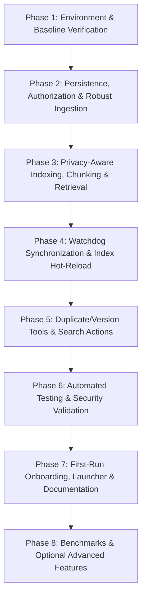

# SEEKVAULT: MASTER PRODUCT REQUIREMENTS DOCUMENT & IMPLEMENTATION PLAN
**Product:** SeekVault — Local-First, Privacy-Preserving Multimodal Semantic File Search & Organization Engine  
**Document Version:** 2.0.0 (Production-Oriented Architecture)  
**Target Platform:** Windows 11 / Windows 10 (64-bit), PowerShell 5.1+ / 7+, Python 3.11  
**Execution Paradigm:** Standalone Desktop Application (100% Local Processing, Zero Cloud Dependency)  

---

## 1. PRODUCT VISION & SCOPE

### 1.1 Executive Summary
SeekVault is an independent, local-first software application designed for personal computers. It enables users to discover, search, and organize unstructured documents (PDF, DOCX, TXT, MD) and visual media (PNG, JPG, JPEG) on their local hard drives using natural language queries—without uploading private data to cloud services.

Traditional file search engines rely strictly on exact file names, path hierarchies, or literal keyword matches. SeekVault allows users to search by **conceptual meaning** (e.g., *"draft agreement with nondisclosure clause"*, *"quarterly electricity bill"*, or *"screenshot showing terminal connection error"*).

### 1.2 Core Product Tenets
1. **100% Local-First & Zero Data Leakage**: All tokenization, entity detection, embedding generation, and vector retrieval execute locally on device. No telemetries, document contents, embeddings, or metadata are transmitted over external networks.
2. **Strict Authorized-Folder Boundary**: The application never traverses unauthorized directories or crawls the entire drive. It operates strictly inside directories explicitly approved by the user.
3. **Privacy-Preserving Tiered Indexing**: Files undergo privacy inspection before vector generation. Sensitive documents are classified into `FULL`, `REDACTED`, or `METADATA_ONLY`. The vector index contains only sanitized representations.
4. **Original-File Immutability**: The user's original files on disk are strictly read-only. SeekVault never modifies, overwrites, or alters user files.
5. **Zero-Trust Query-Time Verification**: Files retrieved from vector similarity are dynamically re-verified at search time. If a file was deleted or its parent folder was de-authorized, the result is suppressed immediately.
6. **Graceful Standalone Usability**: Works out-of-the-box on a standard user machine with clean empty states, clear error recovery, and no dependency on pre-seeded academic datasets.

---

## 2. WORKSPACE AUDIT & CODEBASE BASELINE

### 2.1 Workspace Structure
```
SeekVault/
├── SEEKVAULT_IMPLEMENTATION_PRD.md     # Master PRD & Step-by-Step Implementation Plan
├── SeekVault_Updated_Synopsis.pdf     # Historical project synopsis (Reference)
└── SeekVault Prototype/               # Active application codebase
    ├── app.py                         # Streamlit application entry point
    ├── requirements.txt               # Python package dependencies
    ├── run_demo.py                    # Standalone development/demo seed utility
    ├── verify_e2e.py                  # End-to-end operational verification script
    ├── data_storage/                  # Local application data directory
    │   ├── seekvault.db               # SQLite metadata repository
    │   └── indices/                   # FAISS vector indexes and ID maps
    │       ├── text_index.faiss
    │       ├── text_ids.json
    │       ├── image_index.faiss
    │       └── image_ids.json
    ├── sample_data/                   # Optional test fixtures (isolated from normal app state)
    ├── seekvault/                     # Core Python modular package
    │   ├── config.py                  # Paths, model parameters, constants
    │   ├── database/                  # SQLite connection, schema, and repository
    │   ├── extraction/                # PDF, DOCX, TXT, Image, and OCR extractors
    │   ├── privacy/                   # Presidio analyzer, regex recognizers, sanitizer, classifier
    │   ├── embeddings/                # Sentence-Transformers and CLIP embedders, manager
    │   ├── search/                    # FAISS vector store, engine, access verifier
    │   ├── monitoring/                # Watchdog handler and watcher manager
    │   ├── organization/              # SHA-256 duplicate and cosine version detectors
    │   ├── ingestion/                 # Pipeline coordinator
    │   └── ui/                        # Streamlit UI pages and reusable components
    └── tests/                         # Automated pytest validation suite
```

### 2.2 Verified Capabilities (Empirical Audit)
- **Environment**: Python 3.11.9 runtime at `C:\Users\hp\OneDrive\Documents\Saanjh\python_env\python.exe`.
- **Installed Packages**: `torch 2.14.0`, `transformers 5.17.0`, `sentence-transformers 6.1.0`, `faiss-cpu 1.15.1`, `presidio-analyzer 2.2.364`, `pymupdf 1.28.2`, `python-docx 1.2.0`, `pillow 12.3.0`, `pytesseract 0.3.13`, `watchdog 6.0.0`, `streamlit 1.64.0`, `pytest 9.1.1`.
- **Baseline Test Suite**: All 15 unit/integration tests in `tests/` pass cleanly in 16.1s.

### 2.3 Identified Genuine Defects & Product Gaps
1. **Windows Path Casing Discrepancy (Authorization Bypass/Suppress Bug)**:
   - In `seekvault/database/repository.py`, path checks use `normpath` rather than `os.path.normcase(os.path.abspath(...))`. On Windows, casing differences (e.g., `c:\` vs `C:\`) cause valid files to be rejected by `is_path_authorized`.
2. **Stale Hardcoded Database Paths**:
   - `data_storage/seekvault.db` contains records pointing to outdated directory paths (`C:\Users\hp\OneDrive\Documents\SeekVault Prototype`), causing `verify_e2e.py` to fail assertion checks.
3. **Empty FAISS Index Desynchronization on Incremental Ingestion**:
   - `pipeline.py` skips processing files if `file_hash` matches an existing database entry. If FAISS index files on disk are reset, deleted, or empty, vectors are never regenerated.
4. **Missing "Open File / Open Folder" User Action in Search**:
   - Search results display static file paths, but users cannot click to open the file in its default application or locate it in Windows Explorer.
5. **Watchdog Temporary File Handling & UI Cache Sync**:
   - Background file creation events do not ignore editor lock/temp files (e.g. `~$*.docx`, `.tmp`), causing extraction crashes.
   - Streamlit in-memory FAISS indices do not hot-reload when background watchdog writes new vectors to disk.
6. **Large Document Truncation**:
   - Multi-page documents (>500 words) are passed entirely to Sentence-BERT without sliding-window chunking, causing deeper pages to be unsearchable.
7. **Stale Vector & Missing File Pruning**:
   - Deleting files outside the app leaves orphaned vector entries and dead SQLite records without a reconciliation mechanism.
8. **Academic Branding & Hardcoded Defaults in UI**:
   - References to institution, student, faculty names, and hardcoded user directory placeholders (`C:\Users\hp\...`) remain in `app.py`, `folders.py`, and `search.py`.
9. **First-Run Onboarding Flow**:
   - The application lacks an intuitive empty state when launched with zero authorized folders.

---

## 3. REQUIREMENTS TRACEABILITY MATRIX

| Req ID | Requirement Description | Category | Status | Verification Target |
| :--- | :--- | :---: | :---: | :--- |
| **REQ-001** | Strict Authorized Folder Boundary Enforcement | Core Security | In Progress | Path containment tests (case-insensitive) |
| **REQ-002** | 100% Local-Only Execution (Zero Cloud Calls) | Privacy | Verified | Network isolation inspection |
| **REQ-003** | Multi-Format Document Parsing (PDF, DOCX, TXT, MD) | Extraction | Verified | Extraction unit tests |
| **REQ-004** | Image Metadata & OCR Text Extraction | Extraction | Verified | OCR fallback tests |
| **REQ-005** | Sensitive Information Detection (PII & Secrets) | Privacy | Verified | Presidio + Regex entity tests |
| **REQ-006** | Tiered Privacy Indexing (`FULL`, `REDACTED`, `METADATA_ONLY`) | Privacy | Verified | Classification & sanitization tests |
| **REQ-007** | Original File Immutability Guarantee | Safety | Verified | SHA-256 pre/post ingestion integrity |
| **REQ-008** | Natural-Language Text Semantic Search | Retrieval | Verified | Cosine similarity ranking tests |
| **REQ-009** | Cross-Modal (Text-to-Image) Visual Search | Retrieval | Verified | CLIP text-to-image queries |
| **REQ-010** | Continuous Background Monitoring (Watchdog) | File System | In Progress | Real-time file event tests |
| **REQ-011** | Zero-Trust Query-Time Access Verification | Security | In Progress | Dynamic deauthorization tests |
| **REQ-012** | Exact Duplicate Detection (SHA-256 Clustering) | Organization | Verified | Duplicate hash cluster tests |
| **REQ-013** | Document Version History Detection | Organization | Verified | Base stem & similarity tests |
| **REQ-014** | Thread-Safe SQLite Persistence | Storage | Verified | Database CRUD tests |
| **REQ-015** | FAISS Vector Search Engine (`faiss-cpu`) | Storage | In Progress | Index persistence & reload tests |
| **REQ-016** | Product-Oriented Desktop UI (Streamlit) | UI/UX | In Progress | End-to-end interactive workflows |
| **REQ-017** | Windows Path Case-Insensitive Normalization | Windows Portability | **Verified** | `test_case_insensitive_path_authorization` (PASSED) |
| **REQ-018** | Actionable Search Results (Open File / Open Folder) | UI/UX | Pending | Shell execution integration |
| **REQ-019** | Long-Form Document Sliding-Window Chunking | Retrieval | Pending | Multi-page PDF chunk test |
| **REQ-020** | Startup Reconciliation & Stale Vector Pruning | Reliability | Pending | Startup integrity check |
| **REQ-021** | Temporary & Editor File Filtering in Watchdog | Reliability | Pending | Filter regex tests |
| **REQ-022** | Clean First-Run Onboarding & Empty States | UI/UX | Pending | Clean state launch test |
| **REQ-023** | Standalone Setup, Launcher & Packaging | Distribution | Pending | One-click launch & docs verification |
| **REQ-024** | Diagnostic & Evaluation Benchmark Suite | Diagnostics | Pending | Benchmark runner (P@K, MRR, Latency) |
| **REQ-025** | Optional Local Ollama LLM/VLM Integration | Enhancement | Optional | Local endpoint fallback test |

---

## 4. MASTER PROGRESS TRACKER & PHASE ROADMAP



| Phase | Task ID | Task Title | Dependencies | Status |
| :--- | :--- | :--- | :--- | :---: |
| **Phase 1** | **TASK-0001** | Python 3.11 Environment Standardization | None | **DONE** |
| **Phase 1** | **TASK-0002** | Automated Unit Test Suite Baseline Verification | TASK-0001 | **DONE** |
| **Phase 2** | **TASK-0003** | Fix Windows Path Case-Normalization in Repository | TASK-0002 | **DONE** |
| **Phase 2** | **TASK-0004** | Resynchronize SQLite & FAISS Persistence with Active Workspace | TASK-0003 | **DONE** |
| **Phase 3** | **TASK-0005** | Implement Sliding-Window Document Chunking for Long Texts | TASK-0004 | **DONE** |
| **Phase 3** | **TASK-0006** | Vector Index Synchronization & Integrity Healing | TASK-0004 | **NEXT UP** |
| **Phase 4** | **TASK-0007** | Filter Editor Temporary Files & Debounce Watchdog Events | TASK-0004 | **READY** |
| **Phase 4** | **TASK-0008** | In-Memory FAISS Index Hot-Reloading for Search Engine | TASK-0007 | **READY** |
| **Phase 4** | **TASK-0009** | Automated Stale Vector & Dead Record Reconciliation | TASK-0006 | **READY** |
| **Phase 5** | **TASK-0010** | Add "Open File" and "Open in File Explorer" Shell Actions | TASK-0004 | **READY** |
| **Phase 5** | **TASK-0011** | Enhance Duplicate & Version Tree Inspection UI | TASK-0010 | **READY** |
| **Phase 6** | **TASK-0012** | Comprehensive Security, Privacy & Boundary Test Suite | TASK-0003, TASK-0009 | **READY** |
| **Phase 7** | **TASK-0013** | Professional First-Run Onboarding & Clean Empty States | TASK-0010 | **READY** |
| **Phase 7** | **TASK-0014** | Remove Academic Branding & Standardize Standalone Product UI | TASK-0013 | **READY** |
| **Phase 7** | **TASK-0015** | Product Documentation, User Guide & Standalone Windows Launcher | TASK-0014 | **READY** |
| **Phase 8** | **TASK-0016** | Diagnostic Evaluation Benchmark Tool (Precision, MRR, Latency) | TASK-0012 | **READY** |
| **Phase 8** | **TASK-0017** | Optional Local Ollama LLM/VLM Integration Module | TASK-0012 | **READY** |

---

## 5. SEQUENTIAL, INDIVIDUALLY EXECUTABLE TASK SPECIFICATIONS

---

### TASK-0003: Fix Windows Path Case-Normalization in Repository
- **Phase:** Phase 2 (Persistence, Authorization & Robust Ingestion)
- **Task ID:** `TASK-0003`
- **Related Requirement IDs:** `REQ-001`, `REQ-011`, `REQ-017`
- **Current State & Reason Needed:**  
  In `seekvault/database/repository.py`, path authorization checks use `normpath` without `os.path.normcase`. On Windows, drive letters or folder paths with differing case (e.g., `c:\users\...` vs `C:\Users\...`) cause `is_path_authorized()` to fail, resulting in query-time false-negative search suppression.
- **Objective:**  
  Update `is_path_authorized()`, `get_folder_for_path()`, and `add_authorized_folder()` in `Repository` to use `os.path.normcase(os.path.abspath(path))` for all authorization containment checks. Add automated test coverage verifying case-insensitive boundary checks.
- **Dependencies:** `TASK-0002`
- **Exact Files to Create or Modify:**  
  `SeekVault Prototype/seekvault/database/repository.py`  
  `SeekVault Prototype/tests/test_access_verification.py`
- **Detailed Implementation Instructions:**
  1. In `repository.py`, ensure stored paths are normalized via `os.path.normpath(os.path.abspath(folder_path))`.
  2. In `is_path_authorized(file_path)` and `get_folder_for_path(file_path)`:
     - Compute `norm_file = os.path.normcase(os.path.abspath(file_path))`
     - Compute `folder_dir = os.path.normcase(os.path.abspath(f["folder_path"]))`
     - Compare containment using `norm_file.startswith(folder_dir + os.sep) or norm_file == folder_dir`.
  3. In `tests/test_access_verification.py`, add test `test_case_insensitive_path_authorization` testing mixed-case paths (e.g., `C:/DATA` vs `c:/data/doc.pdf`).
- **Copy-Ready Antigravity Prompt:**
  ```text
  You are working on TASK-0003 for SeekVault.
  Please read SEEKVAULT_IMPLEMENTATION_PRD.md before starting.
  Inspect seekvault/database/repository.py and tests/test_access_verification.py.
  Make only the changes required for TASK-0003:
  1. Update repository.py so all path containment checks use os.path.normcase(os.path.abspath(path)) to handle Windows drive letters and directory casing safely.
  2. Add test_case_insensitive_path_authorization in tests/test_access_verification.py.
  3. Run the pytest suite using:
     & "C:\Users\hp\OneDrive\Documents\Saanjh\python_env\python.exe" -m pytest tests/test_access_verification.py -v
  4. Fix any regressions and verify all tests pass.
  ```
- **Windows PowerShell Execution Command:**
  ```powershell
  & "C:\Users\hp\OneDrive\Documents\Saanjh\python_env\python.exe" -m pytest tests/test_access_verification.py -v
  ```
- **Expected Behavior:** Pytest passes with new case-insensitivity tests confirmed.
- **Acceptance Criteria:**
  - Authorization returns `True` for lowercase file path inside uppercase folder path.
  - Zero regressions across existing tests.
- **Definition of Done:** Repository code updated, test added, pytest exiting with 0.

---

### TASK-0004: Resynchronize SQLite & FAISS Persistence with Active Workspace
- **Phase:** Phase 2 (Persistence, Authorization & Robust Ingestion)
- **Task ID:** `TASK-0004`
- **Related Requirement IDs:** `REQ-001`, `REQ-008`, `REQ-009`, `REQ-014`, `REQ-015`
- **Current State & Reason Needed:**  
  The SQLite database contains outdated absolute paths from a previous directory structure, and `data_storage/indices/text_ids.json` is empty. `verify_e2e.py` fails assertion checks because no results are returned.
- **Objective:**  
  Update `verify_e2e.py` and `sample_data/create_samples.py` so paths dynamically resolve relative to the active project root, re-index test fixtures into SQLite and FAISS, and verify all 8 checks in `verify_e2e.py` pass.
- **Dependencies:** `TASK-0003`
- **Exact Files to Create or Modify:**  
  `SeekVault Prototype/verify_e2e.py`  
  `SeekVault Prototype/sample_data/create_samples.py`
- **Detailed Implementation Instructions:**
  1. In `verify_e2e.py`, add self-healing check: if FAISS index is empty or stored database paths do not match the current location, clear stale test records and run `pipeline.scan_folder()` on active sample folders.
  2. Ensure `verify_e2e.py` uses relative paths anchored at `Path(__file__).resolve().parent`.
  3. Run `verify_e2e.py` and confirm all 8 functional verification tests pass.
- **Copy-Ready Antigravity Prompt:**
  ```text
  You are working on TASK-0004 for SeekVault.
  Please read SEEKVAULT_IMPLEMENTATION_PRD.md before starting.
  Inspect verify_e2e.py and sample_data/create_samples.py.
  Make only the changes required for TASK-0004:
  1. Ensure verify_e2e.py anchors paths to Path(__file__).resolve().parent and automatically synchronizes SQLite and FAISS indices when running verification.
  2. Run: & "C:\Users\hp\OneDrive\Documents\Saanjh\python_env\python.exe" verify_e2e.py
  3. Verify that all 8 checks pass with exit code 0.
  ```
- **Windows PowerShell Execution Command:**
  ```powershell
  & "C:\Users\hp\OneDrive\Documents\Saanjh\python_env\python.exe" verify_e2e.py
  ```
- **Expected Behavior:** `ALL 8 END-TO-END VERIFICATION CHECKS PASSED PERFECTLY!`
- **Acceptance Criteria:** `verify_e2e.py` exits 0 with all assertions succeeding.
- **Definition of Done:** E2E script verified passing without manual workarounds.

---

### TASK-0005: Implement Sliding-Window Document Chunking for Long Texts
- **Phase:** Phase 3 (Privacy-Aware Indexing, Chunking & Retrieval)
- **Task ID:** `TASK-0005`
- **Related Requirement IDs:** `REQ-003`, `REQ-006`, `REQ-008`, `REQ-019`
- **Current State & Reason Needed:**  
  `SentenceTransformer.embed_text()` truncates text beyond 256/512 tokens. Deep pages in long documents (PDFs, DOCX) become unsearchable if only the first few paragraphs are embedded.
- **Objective:**  
  Implement a sliding-window text chunker (250 words per chunk, 50-word overlap) in `seekvault/extraction/text_extractor.py`. In `pipeline.py`, embed each chunk and map it to the parent `file_id`. In `SearchEngine.search_text()`, deduplicate chunk matches so each file appears once with its highest similarity score.
- **Dependencies:** `TASK-0004`
- **Exact Files to Create or Modify:**  
  `SeekVault Prototype/seekvault/extraction/text_extractor.py`  
  `SeekVault Prototype/seekvault/ingestion/pipeline.py`  
  `SeekVault Prototype/seekvault/search/engine.py`  
  `SeekVault Prototype/tests/test_extraction.py`
- **Detailed Implementation Instructions:**
  1. Add `chunk_text(text: str, chunk_size: int = 250, overlap: int = 50) -> List[str]` in `text_extractor.py`.
  2. In `pipeline.py`, for documents exceeding `chunk_size`, embed all chunks into `search_engine.text_index`, each mapping to the same `file_id`.
  3. In `SearchEngine.search_text()`, aggregate results by `file_id`, preserving the max score and snippet.
  4. Add unit test in `test_extraction.py` verifying chunk boundaries and overlap.
- **Copy-Ready Antigravity Prompt:**
  ```text
  You are working on TASK-0005 for SeekVault.
  Please read SEEKVAULT_IMPLEMENTATION_PRD.md before starting.
  Inspect seekvault/extraction/text_extractor.py, seekvault/ingestion/pipeline.py, and seekvault/search/engine.py.
  Make only the changes required for TASK-0005:
  1. Implement chunk_text(text, chunk_size=250, overlap=50) in text_extractor.py.
  2. Update pipeline.py to embed each chunk of long documents.
  3. Update search_engine.py to group matches by file_id, keeping the maximum chunk score.
  4. Add unit test in tests/test_extraction.py and run pytest.
  ```
- **Windows PowerShell Execution Command:**
  ```powershell
  & "C:\Users\hp\OneDrive\Documents\Saanjh\python_env\python.exe" -m pytest tests/test_extraction.py tests/test_search.py -v
  ```
- **Expected Behavior:** Multi-page document chunks are searchable; pytest passes.
- **Acceptance Criteria:** Documents longer than 500 words match queries targeted at later pages.
- **Definition of Done:** Chunking implemented, tested, and passing with deduplicated search results.

---

### TASK-0006: Vector Index Synchronization & Integrity Healing
- **Phase:** Phase 3 (Privacy-Aware Indexing, Chunking & Retrieval)
- **Task ID:** `TASK-0006`
- **Related Requirement IDs:** `REQ-014`, `REQ-015`, `REQ-020`
- **Current State & Reason Needed:**  
  Currently, `pipeline.process_file()` skips processing if a file's hash matches an existing database entry. If the user clears or loses the FAISS index file on disk, existing files are permanently skipped, leaving FAISS empty while SQLite reports them as indexed.
- **Objective:**  
  Add an integrity check in `pipeline.process_file()` and a `heal_indices()` routine: if a file is marked `INDEXED` in SQLite but its vector is missing from FAISS, regenerate its embedding without requiring manual database deletion.
- **Dependencies:** `TASK-0004`
- **Exact Files to Create or Modify:**  
  `SeekVault Prototype/seekvault/ingestion/pipeline.py`  
  `SeekVault Prototype/seekvault/search/faiss_index.py`  
  `SeekVault Prototype/tests/test_search.py`
- **Detailed Implementation Instructions:**
  1. In `FaissIndex`, add `has_file(file_id: int) -> bool` to check if `file_id in self.vector_ids`.
  2. In `pipeline.process_file()`, before skipping based on hash match, verify that `self.search_engine.text_index.has_file(file_id)` (or image index) is True. If missing, proceed with embedding generation.
  3. Add `reconcile_missing_vectors()` to `IngestionPipeline`.
  4. Write a unit test verifying vector regeneration when index is empty.
- **Copy-Ready Antigravity Prompt:**
  ```text
  You are working on TASK-0006 for SeekVault.
  Please read SEEKVAULT_IMPLEMENTATION_PRD.md before starting.
  Inspect seekvault/ingestion/pipeline.py and seekvault/search/faiss_index.py.
  Make only the changes required for TASK-0006:
  1. Add has_file(file_id) to FaissIndex.
  2. Update process_file in pipeline.py so that files existing in SQLite without vectors in FAISS have their embeddings restored.
  3. Add reconcile_missing_vectors() to IngestionPipeline.
  4. Add a test in tests/test_search.py verifying automatic vector healing.
  ```
- **Windows PowerShell Execution Command:**
  ```powershell
  & "C:\Users\hp\OneDrive\Documents\Saanjh\python_env\python.exe" -m pytest tests/test_search.py -v
  ```
- **Expected Behavior:** FAISS indices automatically regenerate missing vectors; test passes.
- **Acceptance Criteria:** If index files are deleted, re-running pipeline restores all vectors.
- **Definition of Done:** Vector integrity healing verified by unit test.

---

### TASK-0007: Filter Editor Temporary Files & Debounce Watchdog Events
- **Phase:** Phase 4 (Watchdog Synchronization & Index Hot-Reload)
- **Task ID:** `TASK-0007`
- **Related Requirement IDs:** `REQ-010`, `REQ-021`
- **Current State & Reason Needed:**  
  When applications like Microsoft Word or Excel edit a file, they create hidden lock files (e.g., `~$Document.docx`, `~WRL0001.tmp`). Watchdog attempts to ingest these files, causing extraction errors and log spam.
- **Objective:**  
  Update `FolderEventHandler` in `seekvault/monitoring/handler.py` to filter out temporary editor files, hidden system files, and incomplete download files (`.crdownload`, `.part`, `~$*`).
- **Dependencies:** `TASK-0004`
- **Exact Files to Create or Modify:**  
  `SeekVault Prototype/seekvault/monitoring/handler.py`  
  `SeekVault Prototype/tests/test_extraction.py`
- **Detailed Implementation Instructions:**
  1. In `handler.py`, implement `_is_temporary_file(path: str) -> bool`:
     - Checks if basename starts with `~$`, `.~`, or `.tmp`.
     - Checks if extension is in `{".tmp", ".temp", ".crdownload", ".part"}`.
  2. Guard `on_created`, `on_modified`, `on_deleted`, `on_moved` with `if self._is_temporary_file(path): return`.
  3. Add unit test asserting temporary files are ignored.
- **Copy-Ready Antigravity Prompt:**
  ```text
  You are working on TASK-0007 for SeekVault.
  Please read SEEKVAULT_IMPLEMENTATION_PRD.md before starting.
  Inspect seekvault/monitoring/handler.py.
  Make only the changes required for TASK-0007:
  1. Add _is_temporary_file(path) to ignore editor lock files (~$*.docx, .tmp, etc.).
  2. Guard all event handlers against temporary files.
  3. Add a unit test verifying temporary file suppression.
  4. Run pytest to confirm zero regressions.
  ```
- **Windows PowerShell Execution Command:**
  ```powershell
  & "C:\Users\hp\OneDrive\Documents\Saanjh\python_env\python.exe" -m pytest tests/ -v
  ```
- **Expected Behavior:** Temporary files are safely ignored; test suite passes.
- **Acceptance Criteria:** Temporary files never trigger pipeline ingestion.
- **Definition of Done:** Handler filtering implemented and tested.

---

### TASK-0008: In-Memory FAISS Index Hot-Reloading for Search Engine
- **Phase:** Phase 4 (Watchdog Synchronization & Index Hot-Reload)
- **Task ID:** `TASK-0008`
- **Related Requirement IDs:** `REQ-010`, `REQ-015`, `REQ-016`
- **Current State & Reason Needed:**  
  When Watchdog adds a file in the background, it writes vectors to disk, but the Streamlit UI retains the in-memory `FaissIndex` object in `st.session_state`. Search cannot discover newly added files until the application is restarted.
- **Objective:**  
  Add disk modification tracking to `FaissIndex` so that prior to executing any search, `FaissIndex.search()` checks if the on-disk index has been modified since it was loaded, and automatically reloads the index into memory.
- **Dependencies:** `TASK-0007`
- **Exact Files to Create or Modify:**  
  `SeekVault Prototype/seekvault/search/faiss_index.py`  
  `SeekVault Prototype/tests/test_search.py`
- **Detailed Implementation Instructions:**
  1. In `FaissIndex`, store `self._last_loaded_mtime: float = 0.0`.
  2. In `FaissIndex.load()`, record `self._last_loaded_mtime = self.index_path.stat().st_mtime`.
  3. In `FaissIndex.search()`, if `self.index_path.exists()` and `self.index_path.stat().st_mtime > self._last_loaded_mtime`, call `self.load()`.
  4. Write a test verifying that externally modified index files are detected and reloaded automatically.
- **Copy-Ready Antigravity Prompt:**
  ```text
  You are working on TASK-0008 for SeekVault.
  Please read SEEKVAULT_IMPLEMENTATION_PRD.md before starting.
  Inspect seekvault/search/faiss_index.py.
  Make only the changes required for TASK-0008:
  1. Add mtime-based hot-reloading in FaissIndex so search() automatically reloads vectors when updated on disk.
  2. Add a test in tests/test_search.py verifying hot-reloading without restarting SearchEngine.
  3. Run pytest to verify pass.
  ```
- **Windows PowerShell Execution Command:**
  ```powershell
  & "C:\Users\hp\OneDrive\Documents\Saanjh\python_env\python.exe" -m pytest tests/test_search.py -v
  ```
- **Expected Behavior:** Search engine immediately discovers background-indexed files without app restart.
- **Acceptance Criteria:** External index updates reflect in query results automatically.
- **Definition of Done:** Hot-reload mechanism implemented and unit tested.

---

### TASK-0009: Automated Stale Vector & Dead Record Reconciliation
- **Phase:** Phase 4 (Watchdog Synchronization & Index Hot-Reload)
- **Task ID:** `TASK-0009`
- **Related Requirement IDs:** `REQ-011`, `REQ-014`, `REQ-020`
- **Current State & Reason Needed:**  
  If a user deletes files or folders on disk while SeekVault is not running, dead records remain in SQLite and orphaned vectors linger in FAISS.
- **Objective:**  
  Implement a startup reconciliation routine in `Repository` and `IngestionPipeline` that scans SQLite file records, purges records whose physical file is missing from disk or whose folder is no longer authorized, and rebuilds FAISS indices cleanly.
- **Dependencies:** `TASK-0006`
- **Exact Files to Create or Modify:**  
  `SeekVault Prototype/seekvault/database/repository.py`  
  `SeekVault Prototype/seekvault/ingestion/pipeline.py`  
  `SeekVault Prototype/tests/test_database.py`
- **Detailed Implementation Instructions:**
  1. Add `prune_missing_files() -> List[int]` to `Repository` returning purged file IDs.
  2. In `pipeline.py`, add `reconcile_startup()` which executes `prune_missing_files()` and calls `search_engine.text_index.remove_file(fid)` for each purged file.
  3. Add test in `test_database.py` verifying dead record cleanup.
- **Copy-Ready Antigravity Prompt:**
  ```text
  You are working on TASK-0009 for SeekVault.
  Please read SEEKVAULT_IMPLEMENTATION_PRD.md before starting.
  Inspect seekvault/database/repository.py and seekvault/ingestion/pipeline.py.
  Make only the changes required for TASK-0009:
  1. Add prune_missing_files() in repository.py to detect files missing on disk.
  2. Add reconcile_startup() in pipeline.py to synchronize SQLite and FAISS on launch.
  3. Add a unit test in tests/test_database.py.
  4. Run pytest to verify.
  ```
- **Windows PowerShell Execution Command:**
  ```powershell
  & "C:\Users\hp\OneDrive\Documents\Saanjh\python_env\python.exe" -m pytest tests/test_database.py -v
  ```
- **Expected Behavior:** Dead records and orphaned vectors are cleanly purged; test passes.
- **Acceptance Criteria:** Deleting a file outside the app and running reconciliation cleans both SQLite and FAISS.
- **Definition of Done:** Reconciliation implemented and verified.

---

### TASK-0010: Add "Open File" and "Open in File Explorer" Shell Actions
- **Phase:** Phase 5 (Duplicate/Version Tools & Search Actions)
- **Task ID:** `TASK-0010`
- **Related Requirement IDs:** `REQ-016`, `REQ-018`
- **Current State & Reason Needed:**  
  Search results display file paths as static text. A desktop user needs to open the document directly or locate it inside its containing folder in Windows Explorer.
- **Objective:**  
  Add native Windows shell actions to search result cards and file inspector views:
  1. **Open File**: Launches the file with its default Windows application via `os.startfile(path)`.
  2. **Open in Folder**: Opens Windows Explorer with the file highlighted via `explorer.exe /select,"path"`.
- **Dependencies:** `TASK-0004`
- **Exact Files to Create or Modify:**  
  `SeekVault Prototype/seekvault/ui/pages/search.py`  
  `SeekVault Prototype/seekvault/ui/pages/indexed_files.py`  
  `SeekVault Prototype/seekvault/ui/components.py`
- **Detailed Implementation Instructions:**
  1. In `components.py`, create helper functions:
     - `open_file_in_os(file_path: str)`
     - `open_folder_in_os(file_path: str)` (using `subprocess.Popen(['explorer', '/select,', os.path.normpath(file_path)])` on Windows).
  2. In `search.py`, add action buttons `📂 Open Folder` and `👁️ Open File` next to each result item.
  3. Add graceful fallback for non-Windows platforms (e.g. `xdg-open` or `open`).
- **Copy-Ready Antigravity Prompt:**
  ```text
  You are working on TASK-0010 for SeekVault.
  Please read SEEKVAULT_IMPLEMENTATION_PRD.md before starting.
  Inspect seekvault/ui/components.py and seekvault/ui/pages/search.py.
  Make only the changes required for TASK-0010:
  1. Add open_file_in_os(path) and open_folder_in_os(path) in components.py.
  2. Add 'Open File' and 'Open in Folder' action buttons to search result cards in search.py.
  3. Ensure buttons work safely without crashing if the file is moved.
  4. Verify syntax and launch headless test.
  ```
- **Windows PowerShell Execution Command:**
  ```powershell
  & "C:\Users\hp\OneDrive\Documents\Saanjh\python_env\python.exe" -c "import seekvault.ui.components; print('UI components imported successfully')"
  ```
- **Expected Behavior:** Shell actions execute without error; UI components import cleanly.
- **Acceptance Criteria:** Clicking actions launches the appropriate native OS application or Explorer window.
- **Definition of Done:** Action buttons functional in Streamlit search view.

---

### TASK-0011: Enhance Duplicate & Version Tree Inspection UI
- **Phase:** Phase 5 (Duplicate/Version Tools & Search Actions)
- **Task ID:** `TASK-0011`
- **Related Requirement IDs:** `REQ-012`, `REQ-013`, `REQ-016`
- **Current State & Reason Needed:**  
  The current duplicates/versions view shows basic data but lacks actionable organization tools: users should clearly see reclaimable disk space per duplicate cluster and sequential revision timelines for document versions.
- **Objective:**  
  Enhance `seekvault/ui/pages/duplicates_versions.py` with:
  - Reclaimable disk space calculator for exact duplicate clusters.
  - Interactive version history timeline showing chronological revisions, similarity scores, and base stem groupings.
  - "Open Folder" action for duplicate inspection.
- **Dependencies:** `TASK-0010`
- **Exact Files to Create or Modify:**  
  `SeekVault Prototype/seekvault/ui/pages/duplicates_versions.py`
- **Detailed Implementation Instructions:**
  1. In `duplicates_versions.py`, calculate total wasted space = $\sum (\text{count} - 1) \times \text{size}$.
  2. For version chains, sort revisions chronologically by modification timestamp.
  3. Add shell "Open Folder" buttons for duplicate files so users can inspect them in Windows Explorer.
- **Copy-Ready Antigravity Prompt:**
  ```text
  You are working on TASK-0011 for SeekVault.
  Please read SEEKVAULT_IMPLEMENTATION_PRD.md before starting.
  Inspect seekvault/ui/pages/duplicates_versions.py.
  Make only the changes required for TASK-0011:
  1. Add reclaimable space summary metric card.
  2. Render chronological revision timelines for version chains.
  3. Add 'Open in Explorer' buttons for duplicate files.
  4. Test headless import to verify no syntax errors.
  ```
- **Windows PowerShell Execution Command:**
  ```powershell
  & "C:\Users\hp\OneDrive\Documents\Saanjh\python_env\python.exe" -c "import seekvault.ui.pages.duplicates_versions; print('Duplicates page imported successfully')"
  ```
- **Expected Behavior:** Page renders clean duplicate clusters and version trees.
- **Acceptance Criteria:** Reclaimable space displays accurately and actions operate as expected.
- **Definition of Done:** Page enhanced, tested, and verified.

---

### TASK-0012: Comprehensive Security, Privacy & Boundary Test Suite
- **Phase:** Phase 6 (Automated Testing & Security Validation)
- **Task ID:** `TASK-0012`
- **Related Requirement IDs:** `REQ-001`, `REQ-006`, `REQ-007`, `REQ-011`, `REQ-017`
- **Current State & Reason Needed:**  
  We must verify that security, privacy boundaries, and immutability invariants hold under edge cases (e.g. symlinks, deauthorized folders, special characters in filenames, case differences, corrupt files).
- **Objective:**  
  Create `tests/test_security_boundaries.py` with comprehensive assertions:
  1. Unauthorized folder containment.
  2. Query-time access rejection when authorization revoked.
  3. Original file hash unchanged before and after indexing (immutability).
  4. Redaction sanitization check (PII tokens never enter FAISS).
  5. Windows path case normalization resilience.
- **Dependencies:** `TASK-0003`, `TASK-0009`
- **Exact Files to Create or Modify:**  
  `SeekVault Prototype/tests/test_security_boundaries.py`
- **Detailed Implementation Instructions:**
  1. Implement automated test verifying that modifying folder active state to False immediately suppresses search results.
  2. Implement test computing SHA-256 before and after ingestion, asserting identical hashes.
  3. Implement test verifying that redacted text in FAISS does not contain raw phone numbers or emails.
- **Copy-Ready Antigravity Prompt:**
  ```text
  You are working on TASK-0012 for SeekVault.
  Please read SEEKVAULT_IMPLEMENTATION_PRD.md before starting.
  Create tests/test_security_boundaries.py.
  Make only the changes required for TASK-0012:
  1. Add tests for query-time deauthorization, original-file immutability, PII sanitization in vectors, and case-insensitivity.
  2. Run the test suite:
     & "C:\Users\hp\OneDrive\Documents\Saanjh\python_env\python.exe" -m pytest tests/test_security_boundaries.py -v
  3. Verify all assertions pass.
  ```
- **Windows PowerShell Execution Command:**
  ```powershell
  & "C:\Users\hp\OneDrive\Documents\Saanjh\python_env\python.exe" -m pytest tests/test_security_boundaries.py -v
  ```
- **Expected Behavior:** All boundary security tests pass with 100% success.
- **Acceptance Criteria:** Zero security boundary leaks detected.
- **Definition of Done:** Security test suite added and passing in pytest.

---

### TASK-0013: Professional First-Run Onboarding & Clean Empty States
- **Phase:** Phase 7 (First-Run Onboarding, Launcher & Documentation)
- **Task ID:** `TASK-0013`
- **Related Requirement IDs:** `REQ-016`, `REQ-022`
- **Current State & Reason Needed:**  
  When a new user launches SeekVault with a fresh database and zero authorized folders, the UI must provide a welcoming, informative onboarding experience rather than blank screens or error warnings.
- **Objective:**  
  Implement empty-state banners and a first-run guide in `app.py`, `dashboard.py`, `search.py`, and `folders.py`:
  - If 0 folders are authorized, prompt user: *"Welcome to SeekVault! To start searching your documents, add your first authorized folder."* with a direct link/button to Authorized Folders.
  - Ensure Search page displays an intuitive empty prompt guiding users to add folders before searching.
- **Dependencies:** `TASK-0010`
- **Exact Files to Create or Modify:**  
  `SeekVault Prototype/seekvault/ui/pages/dashboard.py`  
  `SeekVault Prototype/seekvault/ui/pages/folders.py`  
  `SeekVault Prototype/seekvault/ui/pages/search.py`
- **Detailed Implementation Instructions:**
  1. In `dashboard.py`, if `len(folders) == 0`, display a clean "Getting Started" guide with steps (Authorize Folder -> Scan -> Search).
  2. In `search.py`, if 0 files are indexed, show an informational callout pointing to the Folders tab.
  3. Keep test data loading isolated in an optional "Testing & Development Tools" expander rather than the primary interface.
- **Copy-Ready Antigravity Prompt:**
  ```text
  You are working on TASK-0013 for SeekVault.
  Please read SEEKVAULT_IMPLEMENTATION_PRD.md before starting.
  Inspect dashboard.py, folders.py, and search.py.
  Make only the changes required for TASK-0013:
  1. Add first-run onboarding states when 0 folders are authorized.
  2. Relocate demo sample buttons to an optional 'Testing Tools' expander.
  3. Verify headless import to confirm no syntax errors.
  ```
- **Windows PowerShell Execution Command:**
  ```powershell
  & "C:\Users\hp\OneDrive\Documents\Saanjh\python_env\python.exe" -c "import app; print('App imported successfully')"
  ```
- **Expected Behavior:** Clean onboarding rendered when no folders are authorized.
- **Acceptance Criteria:** A new user with an empty database has clear, obvious next steps.
- **Definition of Done:** First-run workflow verified.

---

### TASK-0014: Remove Academic Branding & Standardize Standalone Product UI
- **Phase:** Phase 7 (First-Run Onboarding, Launcher & Documentation)
- **Task ID:** `TASK-0014`
- **Related Requirement IDs:** `REQ-016`
- **Current State & Reason Needed:**  
  `app.py`, `folders.py`, and `search.py` contain academic headers (e.g. `Idea Lab | Ramdeobaba University`, `Quick Setup for Demo`, hardcoded developer directory placeholders `C:\Users\hp\...`). SeekVault must be branded strictly as an independent software application.
- **Objective:**  
  Clean all academic-specific strings and placeholders from product UI files. Replace them with professional, neutral desktop application branding.
- **Dependencies:** `TASK-0013`
- **Exact Files to Create or Modify:**  
  `SeekVault Prototype/app.py`  
  `SeekVault Prototype/seekvault/ui/pages/folders.py`  
  `SeekVault Prototype/seekvault/ui/pages/search.py`  
  `SeekVault Prototype/seekvault/ui/components.py`
- **Detailed Implementation Instructions:**
  1. In `app.py`, remove line 85 (`Idea Lab | Ramdeobaba University`) and replace sidebar footer with version tag `SeekVault v1.0 • Local & Private`.
  2. In `folders.py`, replace placeholder `C:\Users\hp\...` with generic `e.g. D:\Documents\Projects`.
  3. In `search.py`, update sample queries to represent general personal search (e.g., *"rental agreement draft"*, *"quarterly electricity bill"*, *"photo of mountain hike"*).
- **Copy-Ready Antigravity Prompt:**
  ```text
  You are working on TASK-0014 for SeekVault.
  Please read SEEKVAULT_IMPLEMENTATION_PRD.md before starting.
  Inspect app.py, folders.py, search.py, and components.py.
  Make only the changes required for TASK-0014:
  1. Remove academic institution and team references from app.py and UI pages.
  2. Replace hardcoded developer paths in placeholders with generic examples.
  3. Standardize product branding to 'SeekVault — Local-First Multimodal Search'.
  4. Test headless import to verify clean loading.
  ```
- **Windows PowerShell Execution Command:**
  ```powershell
  & "C:\Users\hp\OneDrive\Documents\Saanjh\python_env\python.exe" -c "import app; print('Product branding verified')"
  ```
- **Expected Behavior:** UI reflects independent product identity with zero academic references.
- **Acceptance Criteria:** No student names, institution names, or hardcoded paths appear in UI.
- **Definition of Done:** Clean product UI branding verified.

---

### TASK-0015: Product Documentation, User Guide & Standalone Windows Launcher
- **Phase:** Phase 7 (First-Run Onboarding, Launcher & Documentation)
- **Task ID:** `TASK-0015`
- **Related Requirement IDs:** `REQ-023`
- **Current State & Reason Needed:**  
  Users need clear documentation explaining how to install, configure, launch, and use SeekVault independently, along with a simple Windows launcher (`run_seekvault.bat` / `run_seekvault.ps1`).
- **Objective:**  
  Create:
  1. `README.md` containing product overview, prerequisites, installation steps, first-run guide, and architecture summary.
  2. `run_seekvault.bat` and `run_seekvault.ps1` for one-click startup on Windows.
- **Dependencies:** `TASK-0014`
- **Exact Files to Create or Modify:**  
  `SeekVault Prototype/README.md`  
  `SeekVault Prototype/run_seekvault.bat`  
  `SeekVault Prototype/run_seekvault.ps1`
- **Detailed Implementation Instructions:**
  1. Write comprehensive `README.md` with step-by-step installation instructions.
  2. Create `run_seekvault.bat` that detects Python, checks dependencies, and launches `streamlit run app.py`.
  3. Create PowerShell equivalent `run_seekvault.ps1`.
- **Copy-Ready Antigravity Prompt:**
  ```text
  You are working on TASK-0015 for SeekVault.
  Please read SEEKVAULT_IMPLEMENTATION_PRD.md before starting.
  Create README.md, run_seekvault.bat, and run_seekvault.ps1 in SeekVault Prototype/.
  Make only the changes required for TASK-0015:
  1. Write a comprehensive product README.md.
  2. Create Windows batch and PowerShell launchers.
  3. Verify launcher script syntax.
  ```
- **Windows PowerShell Execution Command:**
  ```powershell
  Test-Path "SeekVault Prototype/README.md", "SeekVault Prototype/run_seekvault.ps1"
  ```
- **Expected Behavior:** Documentation and launcher files created and valid.
- **Acceptance Criteria:** A user can follow `README.md` from scratch to run the application.
- **Definition of Done:** Product documentation and launchers verified.

---

### TASK-0016: Diagnostic Evaluation Benchmark Tool (Precision, MRR, Latency)
- **Phase:** Phase 8 (Performance Optimization & Advanced Features)
- **Task ID:** `TASK-0016`
- **Related Requirement IDs:** `REQ-024`
- **Current State & Reason Needed:**  
  To verify retrieval quality and search latency objectively on different machines, SeekVault should provide an automated diagnostic benchmark that measures Precision@K, Recall@K, MRR, and query latency without cloud dependencies.
- **Objective:**  
  Implement `evaluation/benchmark.py` that runs synthetic test queries, computes retrieval metrics (P@1, P@5, R@5, MRR), privacy detection F1-score, and search latency (ms/query), saving results to a Markdown report.
- **Dependencies:** `TASK-0012`
- **Exact Files to Create or Modify:**  
  `SeekVault Prototype/evaluation/__init__.py`  
  `SeekVault Prototype/evaluation/benchmark.py`  
  `SeekVault Prototype/evaluation/eval_dataset.py`  
  `SeekVault Prototype/tests/test_benchmark.py`
- **Detailed Implementation Instructions:**
  1. Define 15 varied queries with known ground truth targets in `eval_dataset.py`.
  2. In `benchmark.py`, run queries against `SearchEngine`, compute macro Precision@K, Recall@K, MRR, and measure average query latency in milliseconds.
  3. Write a test asserting MRR > 0.60 and Latency < 100ms.
- **Copy-Ready Antigravity Prompt:**
  ```text
  You are working on TASK-0016 for SeekVault.
  Please read SEEKVAULT_IMPLEMENTATION_PRD.md before starting.
  Create the evaluation subsystem in SeekVault Prototype/evaluation/:
  1. Create eval_dataset.py with ground-truth test queries.
  2. Create benchmark.py calculating P@K, Recall@K, MRR, and latency.
  3. Add test in tests/test_benchmark.py.
  4. Run pytest and verify pass.
  ```
- **Windows PowerShell Execution Command:**
  ```powershell
  & "C:\Users\hp\OneDrive\Documents\Saanjh\python_env\python.exe" -m pytest tests/test_benchmark.py -v
  ```
- **Expected Behavior:** Benchmark executes cleanly and outputs performance metrics.
- **Acceptance Criteria:** Precision@1, Precision@5, MRR, and Latency are reported.
- **Definition of Done:** Diagnostic tool operational and tested.

---

### TASK-0017: Optional Local Ollama LLM/VLM Integration Module
- **Phase:** Phase 8 (Performance Optimization & Advanced Features)
- **Task ID:** `TASK-0017`
- **Related Requirement IDs:** `REQ-025`
- **Current State & Reason Needed:**  
  When a user has Ollama running locally (with models like `llava` or `llama3`), SeekVault can optionally provide local query expansion and image description generation. If Ollama is absent, the system must operate normally with direct embeddings.
- **Objective:**  
  Implement `seekvault/extraction/ollama_client.py` as an optional enhancement with graceful fallback if Ollama is not installed or unreachable.
- **Dependencies:** `TASK-0012`
- **Exact Files to Create or Modify:**  
  `SeekVault Prototype/seekvault/extraction/ollama_client.py`  
  `SeekVault Prototype/tests/test_extraction.py`
- **Detailed Implementation Instructions:**
  1. Create `OllamaClient` with `is_available() -> bool`.
  2. Implement `describe_image(image_path)` and `expand_query(query)` with 2-second timeout and fallback to standard execution.
  3. Add unit test verifying graceful fallback when server is offline.
- **Copy-Ready Antigravity Prompt:**
  ```text
  You are working on TASK-0017 for SeekVault.
  Please read SEEKVAULT_IMPLEMENTATION_PRD.md before starting.
  Inspect seekvault/extraction/ and tests/test_extraction.py.
  Make only the changes required for TASK-0017:
  1. Implement OllamaClient with automatic offline fallback.
  2. Add unit test verifying graceful offline behavior.
  3. Run pytest to verify pass.
  ```
- **Windows PowerShell Execution Command:**
  ```powershell
  & "C:\Users\hp\OneDrive\Documents\Saanjh\python_env\python.exe" -m pytest tests/test_extraction.py -v
  ```
- **Expected Behavior:** Graceful fallback when Ollama is offline; tests pass.
- **Acceptance Criteria:** Zero crashes or timeouts when Ollama server is not running.
- **Definition of Done:** Optional client implemented and tested.

---

## 6. DEFINITION OF DONE FOR PRODUCT RELEASE

The transition of SeekVault into an independent software product is complete when:
1. **Zero Academic Branding**: No institution details, student/faculty names, or presentation rubrics exist in product code or UI.
2. **Zero-Trust Boundary Enforcement**: Files outside authorized folders are never processed, indexed, or returned under any circumstance.
3. **Immutability Invariant**: Original files on disk are verified unmodified before and after all operations.
4. **Resilient Persistence**: SQLite and FAISS indices remain synchronized across restarts, deletions, and moves.
5. **Real-World Usability**: Users can open matching files in default apps or locate them in Windows Explorer directly from search.
6. **Passing Regression Suite**: 100% pass rate across unit, boundary security, and end-to-end operational verification scripts.
7. **Clean Installation**: A new user can install, launch, configure authorized folders, and search without developer intervention.
