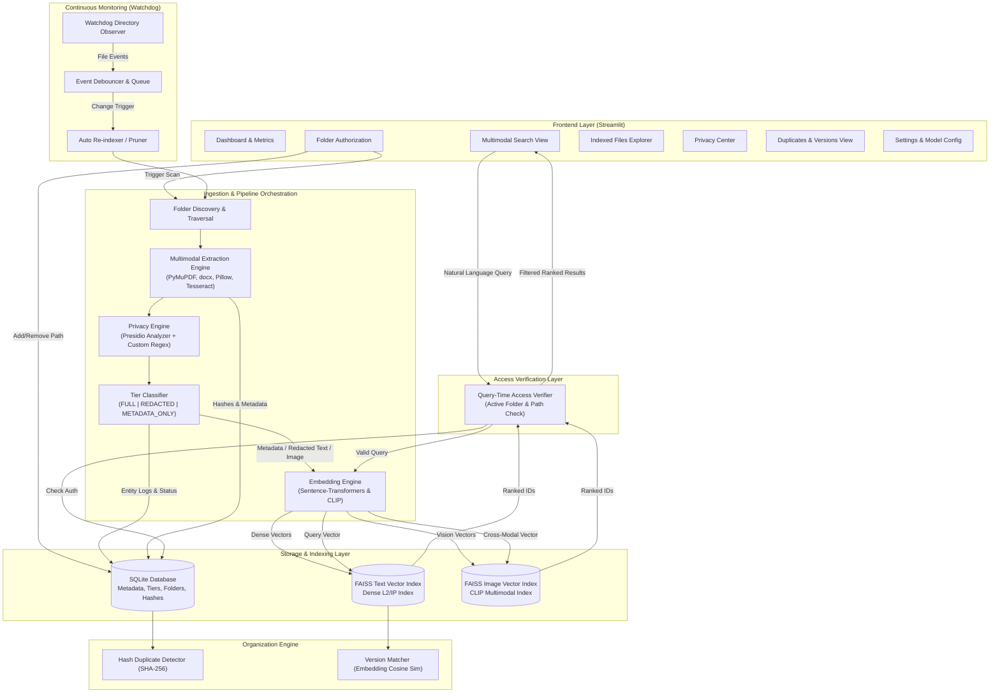

# SeekVault: System Architecture Document

## 1. Executive Summary & Vision

**SeekVault** is a local-first, privacy-aware multimodal semantic file search and organization system. Designed to run completely on-device without third-party cloud data transmission, SeekVault bridges the gap between conventional lexical file search and modern semantic intelligence while enforcing strict, verifiable privacy policies.

Traditional search tools (such as native OS search) rely on rigid filenames, folder structures, or raw keyword matches, failing when users search with conceptual queries (e.g., *"notes on candidate elimination algorithm"* or *"photo of a red car near a building"*). Conversely, modern cloud-assisted AI search tools introduce grave data-privacy and compliance risks when personal or proprietary documents are uploaded.

SeekVault solves this dichotomy through:
1. **User-Controlled Authorization**: Only explicitly whitelisted directories are ingested and monitored.
2. **Tiered Privacy-Preserving Indexing**: Files are scanned before indexing using Presidio and regex to classify content into `FULL`, `REDACTED`, or `METADATA_ONLY` tiers. Original files remain untouched; redaction is applied strictly to the search representations.
3. **Cross-Modal Multimodal Retrieval**: Semantic vector search powered by local Sentence Transformers (text) and CLIP (images) backed by FAISS and SQLite.
4. **Continuous Synchronization**: Real-time file system monitoring via Watchdog with automated index synchronization.
5. **Zero-Trust Query-Time Access Verification**: Validating folder authorization and file existence dynamically at the exact instant a search query executes.
6. **Smart File Organization**: Exact duplicate clustering via cryptographic hashing and document version tracking via semantic cosine similarity.

---

## 2. High-Level System Architecture



---

## 3. Core Component Breakdown

### 3.1. Folder Authorization & Persistence (`seekvault/database`)
* **Role**: Enforces the boundary of SeekVault.
* **Storage**: SQLite table `authorized_folders` storing canonical paths, recursive status, added timestamp, and active status.
* **Invariant**: The system will never scan, inspect, or retain vectors for any path that does not resolve within an authorized root directory.

### 3.2. Multimodal Extraction Engine (`seekvault/extraction`)
* **Text Documents**:
  * **PDF**: Extracted page-by-page via `PyMuPDF` (`fitz`), handling text blocks, embedded metadata, and detecting scanned pages.
  * **DOCX**: Extracted via `python-docx` (paragraphs, headings, tables).
  * **TXT / MD**: Direct local decoding with automatic fallback encoding detection (UTF-8, UTF-16, Latin-1).
* **Images**:
  * Formats: JPG, JPEG, PNG.
  * Extracted via `Pillow` for RGB normalization and dimension extraction.
  * OCR Text extraction via `pytesseract` to allow hybrid retrieval (visual scene + on-image text).

### 3.3. Privacy Engine & Tiered Indexing (`seekvault/privacy`)
* **Detection Engine**:
  * Microsoft Presidio Analyzer supplemented with Custom Pattern Recognizers (e.g., Aadhaar number, Indian/international phone formats, PAN cards, credit cards, emails, person names).
* **Tiered Classification**:
  * **`FULL`**: No critical sensitive entities detected. The extracted content is embedded directly into FAISS.
  * **`REDACTED`**: Sensitive entities detected. The sensitive tokens are masked (e.g., `john@example.com` $\to$ `<EMAIL>`, `+91-9876543210` $\to$ `<PHONE_NUMBER>`). The *redacted* string is passed to Sentence Transformers. The original user file is strictly unmodified.
  * **`METADATA_ONLY`**: Files with extreme sensitivity (e.g., passwords, tax docs, or user-selected override). Zero body text or image embeddings are saved to FAISS. The file is searchable only via filename, path, date, and extension.

### 3.4. Embedding & Vector Search Engine (`seekvault/embeddings`, `seekvault/search`)
* **Text Embeddings**: `all-MiniLM-L6-v2` via `sentence-transformers` (384-dimensional dense vectors, lightning-fast on CPU).
* **Multimodal Image Embeddings**: `clip-ViT-B-32` via `sentence-transformers` (512-dimensional joint text-image embedding space).
  * Enables zero-shot cross-modal retrieval: user inputs *"red car on street"*, vector generated via CLIP text encoder, matched against CLIP image embeddings in FAISS.
* **FAISS Indexing**:
  * Separate `faiss.IndexFlatIP` (Inner Product on normalized embeddings = Cosine Similarity) for Documents (`text_index.faiss`) and Images (`image_index.faiss`).
  * Bidirectional mapping table in SQLite linking FAISS vector IDs to canonical file records.

### 3.5. Continuous File System Monitoring (`seekvault/monitoring`)
* Utilizes `watchdog.observers.Observer` monitoring all active authorized directories recursively.
* Handles:
  * `FileCreatedEvent`: Schedules file for ingestion.
  * `FileModifiedEvent`: Checks SHA-256 hash; if changed, re-extracts, updates privacy tier, and refreshes vectors.
  * `FileDeletedEvent`: Prunes metadata in SQLite, flags FAISS entry as deleted.
  * `FileMovedEvent`: Seamlessly updates canonical path in SQLite without re-embedding if hash remains identical.
* **Debounce Queue**: Prevents churn from rapid temporary writes (e.g., file saving or downloads in progress).

### 3.6. Query-Time Access Verification (`seekvault/search/verifier.py`)
* A security mechanism to guarantee zero leakage:
  * Even if a file's vector resides in FAISS, upon query execution, SeekVault checks:
    1. Does the physical file still exist on disk?
    2. Is the file's current directory tree contained inside an currently **active** authorized folder in SQLite?
  * If authorization was revoked by the user 5 seconds ago, any matching results from that folder are suppressed immediately.

### 3.7. Smart File Organization (`seekvault/organization`)
* **Exact Duplicate Detection**: Cryptographic SHA-256 content hashing. Identifies duplicate files across disparate authorized folders regardless of different filenames.
* **Document Version Detection**:
  * Calculates pairwise cosine similarity between document text embeddings.
  * Files sharing similar naming stems (e.g., `Draft_v1.docx` and `Draft_v2.docx`) or exhibiting semantic similarity $\ge 0.85$ with differing content hashes are clustered as sequential versions.

### 3.8. Streamlit User Interface (`seekvault/ui`)
* Multi-page modular UI with clear visual hierarchy:
  1. **Dashboard**: High-level telemetry, file count distribution, privacy tier gauge, indexing progress, watchdog status.
  2. **Search**: Natural language query input, multimodal search toggle (Text / Image / All), similarity score threshold slider, privacy badges, dynamic snippet preview with highlighted matches, image thumbnails.
  3. **Authorized Folders**: Path selector, recursive toggle, folder removal, one-click manual re-index.
  4. **Indexed Files**: Paginated search/filter table of all known files with privacy status and hashes.
  5. **Privacy Center**: Audit logs of all detected PII, entity breakdown charts, inspection of redacted search representations.
  6. **Duplicates & Versions**: Visual clusters of duplicate files with reclaimable space counters, version timelines.
  7. **Settings**: Model selections, OCR configuration, privacy threshold parameters.

---

## 4. Data Flow Diagram

```
[ User File on Disk ] 
         │
         ▼
[ Folder Authorization Check ] ──(If unauthorized)──► [ IGNORE ]
         │
         ▼ (If authorized)
[ File Extraction (PyMuPDF / docx / Pillow / OCR) ]
         │
         ▼
[ SHA-256 Checksum ] ──► [ SQLite Deduplication Check ]
         │
         ▼
[ Presidio & Regex Privacy Scanning ]
         │
 ┌───────┼──────────────────────────┐
 │       │                          │
 ▼       ▼                          ▼
(Clean) (PII Found)          (Extreme/Confidential)
 │       │                          │
 │       ▼ (Redact Tokens)          │
 │   [ Sanitized Text ]             │
 │       │                          │
 ▼       ▼                          ▼
[ Generate Vector Embeddings ]    [ No Embeddings ]
 (Sentence-Transformers / CLIP)             │
         │                                  │
         ▼                                  ▼
[ Write to FAISS Index ]          [ Update SQLite Status ]
         │                                  │
         └─────────────────┬────────────────┘
                           ▼
                 [ Ingest Complete ]
```

---

## 5. Technology Matrix

| Subsystem | Selected Tool / Library | Justification / Role |
| :--- | :--- | :--- |
| **Frontend** | Streamlit | Rapid interactive prototyping, rich widget library, native state management. |
| **Database** | SQLite3 | Local, zero-configuration ACID storage for metadata, paths, and mappings. |
| **Vector Engine** | FAISS (`faiss-cpu`) | High-performance local similarity search on dense vectors. |
| **Text Embedding**| `sentence-transformers` (`all-MiniLM-L6-v2`) | State-of-the-art CPU-efficient 384-d semantic text embeddings. |
| **Vision Embedding**| `CLIP` (`clip-ViT-B-32`) | Cross-modal text-to-image semantic matching. |
| **Document Parsing**| `PyMuPDF` (`fitz`), `python-docx` | Fast text extraction from PDF and Word documents. |
| **Image & OCR** | `Pillow`, `pytesseract` | Image decoding, resizing, EXIF, and optical character recognition. |
| **Privacy / PII** | Microsoft `presidio-analyzer`, Regex | Standardized NER + pattern-based sensitive data detection. |
| **File Watcher** | `watchdog` | OS-native event hooks for real-time file updates. |
| **Local LLM (Opt)**| `Ollama` (API client) | Optional local summarization and image descriptions when present. |
