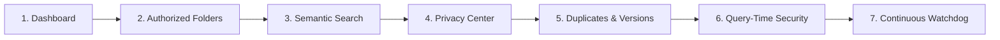

# SeekVault: Comprehensive Prototype Walkthrough & Demonstration Guide

> **Project Name:** SeekVault — Local-First, Privacy-First Multimodal Semantic Search  
> **Institution:** Ramdeobaba University, Dept. of Computer Science & Engineering | IDEA Lab  
> **Authors:** Abha Bhondge, Bhoomi Batra, Harsh Maske, Aarya Rohikar  
> **Guide:** Prof. Nupur Jaiswal (Banode) | **Coordinator:** Prof. Gulrukh Nazneen  

---

## 1. Executive Summary

**SeekVault** addresses the fundamental flaw of legacy desktop search engines (like Windows Search): they rely on rigid filenames, explicit keywords, and static folder structures. If a student forgets a filename—such as remembering only *"notes about candidate elimination"* or *"screenshot showing my Java error"*—traditional search fails. Conversely, modern cloud-assisted AI assistants create severe privacy liabilities by transmitting sensitive personal data to remote servers.

SeekVault solves this by providing:
1. **100% Local-First Processing**: Embeddings, vector matching, and PII scanning execute entirely on-device without cloud dependencies.
2. **User-Controlled Authorization**: Only explicitly approved directories are processed and monitored.
3. **Privacy-Preserving Tiered Indexing**: Automatic detection of PII (Aadhaar, PAN, emails, phone numbers, passwords) categorizes files into `FULL`, `REDACTED`, or `METADATA_ONLY`. Search vectors use sanitized representations while original user files are **strictly never altered**.
4. **Cross-Modal Retrieval**: Joint text and image semantic search powered by Sentence-Transformers and CLIP over FAISS indices.
5. **Zero-Trust Query-Time Access Verification**: Dynamic suppression of revoked folders or deleted files at query time.
6. **Smart File Organization**: Exact duplicate clustering via SHA-256 and sequential revision tracking via semantic embedding cosine similarity.

---

## 2. Quick-Start Guide

### Launching the Application
Open a terminal in the project directory and run:

```powershell
# Direct launch using the installed virtual environment
& "C:\Users\hp\OneDrive\Documents\Saanjh\python_env\python.exe" -m streamlit run app.py --server.port 8502
```

Or run the all-in-one demo launcher:
```powershell
& "C:\Users\hp\OneDrive\Documents\Saanjh\python_env\python.exe" run_demo.py
```

Open your browser to:
👉 **`http://localhost:8502`**

---

## 3. Step-by-Step Live Demonstration Script

Follow this sequential walkthrough during evaluations or project demonstrations.



---

### Step 1: The Overview Dashboard (`📊 Dashboard`)
* **Where to navigate:** Click **📊 Dashboard** in the left sidebar.
* **What you see:**
  * **Top Metrics**: Active Authorized Folders (`4`), Total Indexed Files (`12`), Documents (`9`), Images (`3`), Watchdog Status (`ACTIVE`).
  * **Privacy Tier Distribution Chart**: Real-time breakdown showing `FULL` (9 files), `REDACTED` (2 files), and `METADATA_ONLY` (1 file).
  * **File Organization Stats**: Detected Duplicate Groups and Version History Trees.
  * **Active Watched Paths**: Console view of directories actively watched by the background daemon.
* **Talking Point for Evaluators:**  
  *"SeekVault starts with real-time telemetry. Notice how privacy is quantified from the start: every indexed file has a verifiable privacy classification, and the background filesystem watcher is already active."*

---

### Step 2: Folder Authorization Control (`📁 Authorized Folders`)
* **Where to navigate:** Click **📁 Authorized Folders** in the left sidebar.
* **Demonstration Action:**
  1. Show the four pre-loaded authorized test folders:
     * `sample_data/authorized_academic`
     * `sample_data/authorized_personal`
     * `sample_data/authorized_images`
     * `sample_data/authorized_versions`
  2. Explain the **Quick Setup** buttons that enable one-click re-indexing of any sample collection.
  3. Show how folders can be marked **Inactive** using the toggle switch or deleted using the **Remove** button.
* **Talking Point for Evaluators:**  
  *"In SeekVault, privacy begins at the folder boundary. The application does not crawl the entire disk. It operates only within directories explicitly granted by the user. If an unauthorized directory exists—such as `sample_data/unauthorized_folder`—SeekVault will never read it."*

---

### Step 3: Semantic Natural Language Search (`🔍 Semantic Search`)
* **Where to navigate:** Click **🔍 Semantic Search** in the left sidebar.

#### Part A: Conceptual Document Search (No exact keywords needed!)
1. Type into the search box:
   ```
   notes about candidate elimination
   ```
2. **Observation:**
   * Top result: `ML_Unit3_Notes.pdf` (Similarity score: `0.469` / 47% match).
   * Notice that the query uses words not present in the generic filename `ML_Unit3_Notes.pdf`.
   * Click **📄 View Content Preview** to see the extracted text explaining the Version Space and Specific/General boundaries.
3. Next query:
   ```
   database normalization
   ```
4. **Observation:**
   * Top result: `DBMS_Lecture_4.docx` with an outstanding **76.3% similarity score**.
   * Shows 1NF, 2NF, 3NF, and BCNF table decompositions.
5. Next query:
   ```
   Java concurrency and exceptions
   ```
6. **Observation:**
   * Returns `Java_Concurrency_Notes.txt` matching thread lifecycle, synchronized locks, and try-catch blocks.

#### Part B: Cross-Modal Multimodal Vision Search (Text $\to$ Image)
Change the **Search Modality** dropdown to **Images Only** or leave as **All (Multimodal)**:
1. Type:
   ```
   red car near a building
   ```
2. **Observation:**
   * Top result: `car_parked.jpg`.
   * A thumbnail preview is rendered directly inside the result card alongside dimensions (`640x480 px`), aspect ratio, and color mode (`RGB`).
3. Type:
   ```
   screenshot containing Java error
   ```
4. **Observation:**
   * Top result: `java_error_screenshot.png`.
   * Renders the screenshot thumbnail showing the dark console terminal and `NullPointerException` stack trace.
5. Type:
   ```
   photo of a classroom
   ```
6. **Observation:**
   * Top result: `classroom_lecture.jpg`.
* **Talking Point for Evaluators:**  
  *"SeekVault bridges text and vision seamlessly. Using the joint multimodal space of CLIP and FAISS, users can search images using natural language descriptions without needing manual image tagging."*

---

### Step 4: Privacy Detection & Sanitization Audit (`🛡️ Privacy Center`)
* **Where to navigate:** Click **🛡️ Privacy Center** in the left sidebar.
* **Demonstration Action:**
  1. Review the three defined privacy tiers:
     * **`FULL`**: Clean academic notes; 100% of text/image content embedded.
     * **`REDACTED`**: Files containing personal sensitive information. Sensitive tokens are substituted with placeholders in index vectors.
     * **`METADATA_ONLY`**: Sensitive secrets (passwords, private keys); no content embeddings stored.
  2. Inspect the **Detected Sensitive Entities** table:
     * Shows detected tokens: Aadhaar Number (`4521 8963 1254`), Email addresses, PAN Card numbers (`ABCDE1234F`), and phone numbers.
  3. Now navigate to **📄 Indexed Files** $\to$ Select `Student_Admission_Form.pdf` in the **Deep File Inspector**:
     * Compare the **Original Extracted Text** against the **Searchable / Redacted Representation**:
     * *Original:* `Contact Email: harsh.maske@ramdeobaba.edu | Mobile: +91 9876543210 | Aadhaar: 4521 8963 1254`
     * *Redacted Representation:* `Contact Email: <EMAIL_ADDRESS> | Mobile: <PHONE_NUMBER> | Aadhaar: <AADHAAR_NUMBER>`
* **Talking Point for Evaluators:**  
  *"Notice our core design guarantee: the user's original file on disk is strictly untouched. Redaction happens exclusively in the mathematical vector index representation, ensuring sensitive identities are never leaked into vector databases."*

---

### Step 5: Organization: Duplicates & Versions (`👯 Duplicates & Versions`)
* **Where to navigate:** Click **👯 Duplicates & Versions** in the left sidebar.

#### Part A: Exact Hash Duplication (Tab 1)
* **What you see:**
  * Shows Cluster #1 containing `ML_Unit3_Notes.pdf` and `ML_Unit3_Notes_Copy.pdf`.
  * Identifies identical SHA-256 hashes (`3749e4a7bcc3...`).
  * Calculates potential reclaimable disk storage.

#### Part B: Semantic Document Version History (Tab 2)
* **What you see:**
  * Shows the version group: `Versions of 'Project_report'`.
  * **Version 1:** `Project_Report_Draft_v1.docx`
  * **Version 2:** `Project_Report_Draft_v2.docx` (with 85%+ semantic similarity).
  * Explains how SeekVault uses stem heuristics and embedding cosine similarity to detect sequential revisions of academic papers and reports.

---

### Step 6: Zero-Trust Query-Time Access Verification
This is one of the strongest security features to demonstrate to the evaluators:
1. In **📁 Authorized Folders**, find `sample_data/authorized_personal` and switch the toggle to **Inactive**.
2. Immediately go to **🔍 Semantic Search** and run:
   ```
   Student admission form harsh maske
   ```
3. **Result:**  
   The file is **NOT returned**!
4. **Why this matters:** Even though the vector embedding was stored in FAISS, SeekVault's [`AccessVerifier`](file:///c:/Users/hp/OneDrive/Documents/SeekVault%20Prototype/seekvault/search/verifier.py) intercepts the raw candidates and validates that the file belongs to an *active* authorized folder before returning any results to the user.
5. Re-enable the folder toggle, re-run the search, and the file instantly reappears.

---

### Step 7: Continuous Monitoring (Watchdog in Action)
1. Ensure the dashboard shows `⚡ Watchdog Monitor: ACTIVE`.
2. Open File Explorer or a terminal, and copy any text file or image into `sample_data/authorized_academic/Live_Demo_Note.txt`.
3. Within 1–2 seconds, Watchdog's debounced event handler intercepts the file creation, extracts text, computes privacy classification, and adds vectors to FAISS automatically.
4. Without restarting the Streamlit app, search for the content of the new note in the search tab. It appears immediately.

---

## 4. Automated Test Suite & Code Quality

SeekVault includes an automated test suite verifying every component.

### Running Pytest
Run from terminal:
```powershell
& "C:\Users\hp\OneDrive\Documents\Saanjh\python_env\python.exe" -m pytest tests -v
```

**Results Summary:**
```
tests/test_access_verification.py::test_query_time_access_verification PASSED
tests/test_database.py::test_folder_authorization PASSED
tests/test_database.py::test_file_upsert_and_privacy PASSED
tests/test_embeddings.py::test_text_embedder PASSED
tests/test_embeddings.py::test_semantic_similarity_ranking PASSED
tests/test_extraction.py::test_plain_text_extraction PASSED
tests/test_extraction.py::test_image_metadata_extraction PASSED
tests/test_extraction.py::test_ocr_fallback PASSED
tests/test_organization.py::test_duplicate_hashing_and_detection PASSED
tests/test_organization.py::test_version_stem_extraction PASSED
tests/test_privacy.py::test_detect_email_and_phone PASSED
tests/test_privacy.py::test_detect_aadhaar_and_pan PASSED
tests/test_privacy.py::test_sanitization_placeholders PASSED
tests/test_privacy.py::test_classification_tiers PASSED
tests/test_search.py::test_semantic_text_search PASSED

============================= 15 passed in 16.59s =============================
```

### Running the End-to-End Verification Script
Run:
```powershell
& "C:\Users\hp\OneDrive\Documents\Saanjh\python_env\python.exe" verify_e2e.py
```
This script runs all 8 critical operational scenarios in a single execution and prints formatted validation outputs.

---

## 5. Technology Stack Mapping

| Component | Library / Framework | Implementation Location |
|---|---|---|
| **Frontend UI** | Streamlit 1.64 | [`app.py`](file:///c:/Users/hp/OneDrive/Documents/SeekVault%20Prototype/app.py), [`seekvault/ui/`](file:///c:/Users/hp/OneDrive/Documents/SeekVault%20Prototype/seekvault/ui) |
| **Relational Storage** | SQLite 3 | [`seekvault/database/`](file:///c:/Users/hp/OneDrive/Documents/SeekVault%20Prototype/seekvault/database) |
| **Vector Engine** | FAISS (`faiss-cpu`) | [`seekvault/search/faiss_index.py`](file:///c:/Users/hp/OneDrive/Documents/SeekVault%20Prototype/seekvault/search/faiss_index.py) |
| **Text Embedder** | Sentence-Transformers (`all-MiniLM-L6-v2`) | [`seekvault/embeddings/text_embedder.py`](file:///c:/Users/hp/OneDrive/Documents/SeekVault%20Prototype/seekvault/embeddings/text_embedder.py) |
| **Vision Embedder** | OpenAI CLIP (`clip-ViT-B-32`) | [`seekvault/embeddings/image_embedder.py`](file:///c:/Users/hp/OneDrive/Documents/SeekVault%20Prototype/seekvault/embeddings/image_embedder.py) |
| **Document Parsers** | PyMuPDF (`fitz`), `python-docx` | [`seekvault/extraction/text_extractor.py`](file:///c:/Users/hp/OneDrive/Documents/SeekVault%20Prototype/seekvault/extraction/text_extractor.py) |
| **Image & OCR** | Pillow, `pytesseract` | [`seekvault/extraction/image_extractor.py`](file:///c:/Users/hp/OneDrive/Documents/SeekVault%20Prototype/seekvault/extraction/image_extractor.py) |
| **Privacy Detection**| Presidio Analyzer + Regex Patterns | [`seekvault/privacy/`](file:///c:/Users/hp/OneDrive/Documents/SeekVault%20Prototype/seekvault/privacy) |
| **File Monitoring** | Watchdog | [`seekvault/monitoring/`](file:///c:/Users/hp/OneDrive/Documents/SeekVault%20Prototype/seekvault/monitoring) |
| **Deduplication** | SHA-256 Hashing | [`seekvault/organization/duplicate_detector.py`](file:///c:/Users/hp/OneDrive/Documents/SeekVault%20Prototype/seekvault/organization/duplicate_detector.py) |
| **Versioning** | Stemming + Cosine Similarity | [`seekvault/organization/version_detector.py`](file:///c:/Users/hp/OneDrive/Documents/SeekVault%20Prototype/seekvault/organization/version_detector.py) |

---

## 6. Demonstration FAQ for Evaluators

**Q1: How does SeekVault differ from Windows Search?**  
*Traditional Windows Search uses literal keywords and filenames. SeekVault maps concepts into continuous semantic embedding spaces, allowing users to find files based on meaning, concepts, and visual appearance.*

**Q2: What prevents private or sensitive data from leaking into AI indices?**  
*Our multi-tier privacy pipeline scans extracted text using Presidio and regex recognizers. If sensitive PII (Aadhaar, PAN, phone, email) is present, the file is classified as `REDACTED` and tokens are masked with generic placeholders before vectors are calculated. Highly sensitive files are designated `METADATA_ONLY`, preventing any content vectors from being saved.*

**Q3: Does SeekVault modify user documents?**  
*Never. Original documents on disk are strictly read-only. Sanitization and placeholder substitution occur solely inside the search engine's in-memory index representation.*

**Q4: How does query-time access verification protect user privacy?**  
*If a user revokes folder authorization or deletes a file, SeekVault's query verifier intercepts candidate FAISS vectors before presentation and suppresses unauthorized results instantly, eliminating the risk of residual index leakage.*
